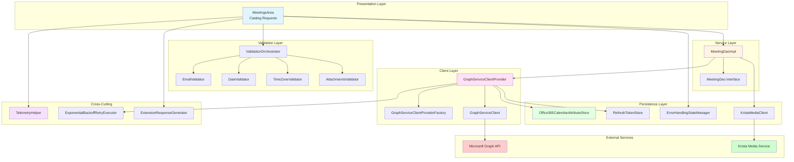
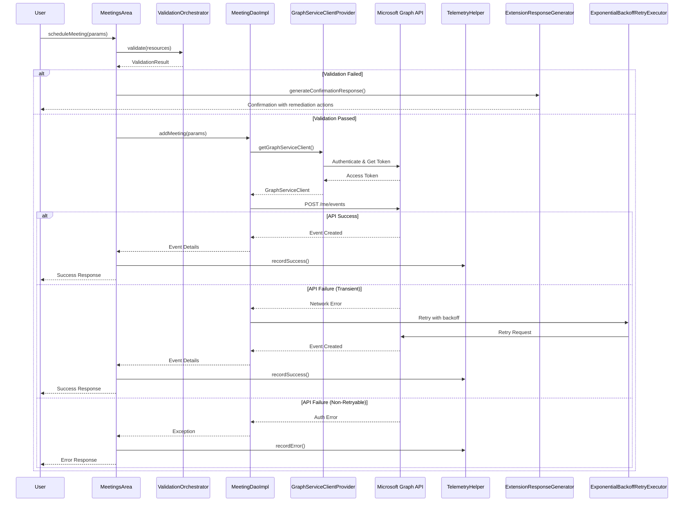
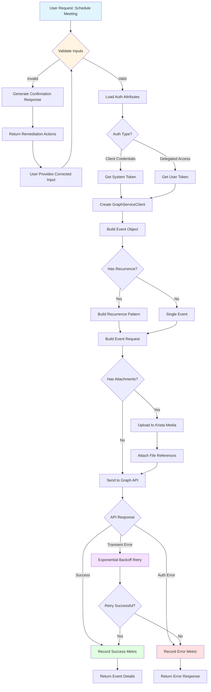
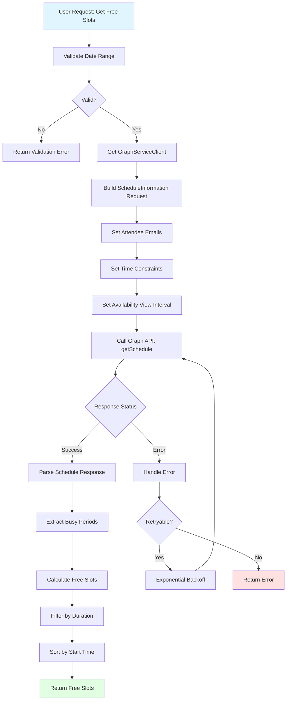
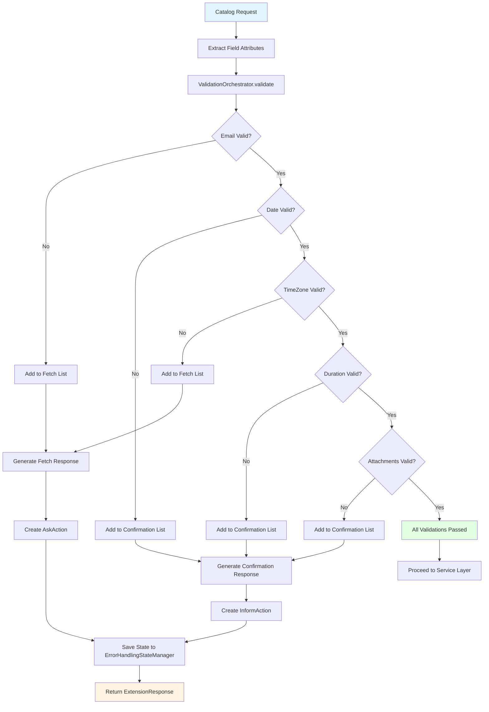
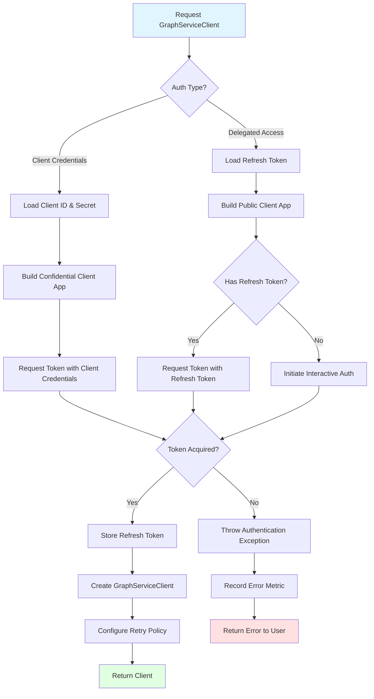

# Office 365 Calendar Extension - Architecture Documentation

## 📋 Table of Contents
1. [Overview](#overview)
2. [Architecture Layers](#architecture-layers)
3. [Component Diagrams](#component-diagrams)
4. [Data Flow](#data-flow)
5. [Performance Limitations](#performance-limitations)
6. [Error Scenarios](#error-scenarios)
7. [Security Considerations](#security-considerations)
8. [Monitoring & Observability](#monitoring--observability)
9. [Future Enhancements](#future-enhancements)

---

## 1. Overview

The **Office 365 Calendar Extension** is a Java 21-based integration that enables seamless interaction with Microsoft Office 365 Calendar services through the Microsoft Graph API. It provides comprehensive calendar management capabilities including meeting scheduling, attendee management, free/busy slot detection, and event querying.

### Key Features
- ✅ **Meeting Management**: Schedule, update, cancel, and query meetings
- ✅ **Attendee Operations**: Add, remove, accept, decline, and tentatively accept invitations
- ✅ **Smart Scheduling**: Find free slots and analyze attendee availability
- ✅ **Teams Integration**: Support for Microsoft Teams meetings
- ✅ **Recurrence Support**: Handle recurring events with complex patterns
- ✅ **Attachment Handling**: Support for multiple file formats
- ✅ **Error Handling**: Comprehensive validation and remediation flows
- ✅ **Retry Mechanism**: Exponential backoff for transient failures
- ✅ **Telemetry**: Built-in monitoring and performance tracking

### Technology Stack
- **Java Version**: Java 21
- **Build Tool**: Gradle
- **Framework**: Krista Extension Framework
- **Dependency Injection**: HK2
- **External API**: Microsoft Graph API
- **Authentication**: OAuth 2.0 (Client Credentials & Delegated Access)
- **Logging**: SLF4J with Log4j2
- **Testing**: JUnit 5, Mockito

---

## 2. Architecture Layers

The extension follows a **5-layer architecture** pattern for separation of concerns and maintainability:

### 2.1 Presentation Layer (Catalog)
**Location**: `app.krista.extensions.essentials.collaboration.office_365_calendar.catalog`

**Components**:
- **MeetingsArea**: Main catalog area exposing 20+ catalog requests for meeting operations
  - `scheduleMeeting()` - Create new meetings with recurrence support
  - `updateMeeting()` - Modify existing meetings
  - `cancelMeeting()` - Cancel meetings
  - `getFreeSlots()` - Find available time slots
  - `getSchedules()` - Get attendee schedules
  - `addAttendees()` - Add participants to meetings
  - `removeAttendee()` - Remove participants
  - `acceptInvitation()` - Accept meeting invitations
  - `declineInvitation()` - Decline meeting invitations
  - `tentativeInvitation()` - Tentatively accept invitations
  - `forwardEvent()` - Forward meeting invitations
  - `getEvent()` - Retrieve event details
  - `getEventsForUser()` - Get user's events
  - `getNextUpcomingMeetings()` - Get upcoming meetings
  - `searchEvents()` - Search events by query

**Responsibilities**:
- Request parameter validation
- Input transformation
- Response formatting
- Error handling orchestration
- Telemetry tracking

### 2.2 Service Layer
**Location**: `app.krista.extensions.essentials.collaboration.office_365_calendar.service`

**Components**:
- **MeetingDao** (Interface): Defines contract for meeting operations
- **MeetingDaoImpl**: Core business logic implementation
  - Meeting CRUD operations
  - Attendee management
  - Free/busy slot calculation
  - Schedule retrieval
  - Event search
  - Recurrence pattern handling
  - Time zone management

**Responsibilities**:
- Business logic execution
- Data transformation
- Graph API interaction
- Time zone conversions
- Recurrence pattern processing

### 2.3 Client Layer
**Location**: `app.krista.extensions.essentials.collaboration.office_365_calendar.impl.connectors`

**Components**:
- **GraphServiceClientProvider**: Creates and manages Graph API clients
  - System authentication (Client Credentials flow)
  - User authentication (Delegated Access flow)
  - Token acquisition and refresh
  - Retry mechanism integration
- **GraphServiceClientProviderFactory**: Factory for creating providers
- **GraphServiceClientAuthenticationProvider**: Custom authentication provider

**Responsibilities**:
- Authentication management
- Token lifecycle management
- HTTP client configuration
- Retry policy enforcement
- Network error handling

### 2.4 Persistence Layer
**Location**: `app.krista.extensions.essentials.collaboration.office_365_calendar.impl.stores`

**Components**:
- **Office365CalendarAttributeStore**: Stores authentication attributes
  - Client ID, Client Secret, Tenant ID
  - Email, Time Zone, Auth Type
- **RefreshTokenStore**: Manages OAuth refresh tokens
- **ErrorHandlingStateManager**: Stores validation and error states
- **KristaMediaClient**: Handles file operations

**Responsibilities**:
- Credential storage and retrieval
- Token persistence
- State management for error flows
- File upload/download

### 2.5 Cross-Cutting Concerns

#### Validation Layer
**Location**: `app.krista.extensions.essentials.collaboration.office_365_calendar.catalog.validators`

**Components**:
- **ValidationOrchestrator**: Coordinates validation across multiple validators
- **EmailValidator**: Validates email addresses
- **DateValidator**: Validates date ranges
- **TimeZoneValidator**: Validates time zones
- **RecurrenceIntervalValidator**: Validates recurrence intervals
- **DaysOfWeekValidator**: Validates day selections
- **NumberValidator**: Validates numeric inputs
- **MeetingDurationValidator**: Validates meeting duration (5 min - 1440 min)
- **AttachmentsValidator**: Validates file formats and attachments
- **EventIdValidator**: Validates event IDs

#### Error Handling Layer
**Location**: `app.krista.extensions.essentials.collaboration.office_365_calendar.catalog.errorhandlers`

**Components**:
- **ErrorHandlingStateManager**: Manages error states
- **ExtensionResponseGenerator**: Generates error responses
- **RemediationActionFactory**: Creates remediation actions
- **ExtensionResponseBuilder**: Builds extension responses

#### Retry Mechanism
**Location**: `app.krista.extensions.essentials.collaboration.office_365_calendar.impl.util`

**Components**:
- **ExponentialBackoffRetryExecutor**: Implements exponential backoff
- **RetryConfiguration**: Configures retry parameters
  - Default: 3 attempts, 1000ms initial delay, 2.0 multiplier, 30000ms max delay
- **RetryableOperation**: Functional interface for retryable operations

#### Telemetry Layer
**Location**: `app.krista.extensions.essentials.collaboration.office_365_calendar.impl.util`

**Components**:
- **TelemetryHelper**: Records metrics and performance data
  - Success/failure counters
  - Duration tracking
  - Validation error tracking
  - Retry attempt tracking

---

## 3. Component Diagrams

### 3.1 High-Level Architecture



### 3.2 Component Interaction Flow



---

## 4. Data Flow

### 4.1 Schedule Meeting Flow



### 4.2 Get Free Slots Flow



### 4.3 Error Handling & Validation Flow




### 4.4 Authentication Flow



---

## 5. Performance Limitations

### 5.1 Microsoft Graph API Rate Limits

Microsoft Graph API enforces **throttling policies** to ensure service stability:

| Resource Type | Throttling Limit | Time Window | Impact |
|--------------|------------------|-------------|---------|
| **Per User** | 10,000 requests | 10 minutes | User-specific operations (delegated access) |
| **Per App** | 150,000 requests | 10 minutes | Application-wide operations (client credentials) |
| **Per Tenant** | 2,000,000 requests | 10 minutes | Tenant-wide limit across all apps |
| **Concurrent Requests** | 5 requests | Per connection | Parallel request limit |

**Throttling Response**:
- HTTP Status: `429 Too Many Requests`
- Header: `Retry-After: <seconds>`
- Recommended Action: Exponential backoff with jitter

**Extension Handling**:
- ✅ Exponential backoff retry mechanism
- ✅ Configurable retry attempts (default: 3)
- ✅ Respects `Retry-After` header
- ❌ No request queuing or rate limiting prevention

### 5.2 Token Expiration & Refresh Overhead

**Access Token Lifecycle**:
- **Expiration**: 60-90 minutes (typically 1 hour)
- **Refresh Token Expiration**: 90 days (rolling window)
- **Token Acquisition Time**: 200-500ms per request

**Performance Impact**:
- First request after token expiration: +200-500ms latency
- Token refresh overhead: ~2-5% of total request time
- Concurrent requests may trigger multiple token acquisitions

**Mitigation**:
- ✅ Token caching in RefreshTokenStore
- ✅ Refresh token reuse
- ❌ No proactive token refresh before expiration

### 5.3 Network Latency & Timeouts

**Default Timeout Configuration**:
- **Connection Timeout**: 60 seconds
- **Read Timeout**: 60 seconds
- **Write Timeout**: 60 seconds

**Latency Factors**:
- Microsoft Graph API response time: 100-2000ms (varies by operation)
- Network round-trip time: 50-300ms
- TLS handshake: 100-200ms (first request)

**High-Latency Operations**:
| Operation | Avg Latency | Max Latency | Notes |
|-----------|-------------|-------------|-------|
| `scheduleMeeting` | 500ms | 3000ms | Includes validation & notification |
| `getFreeSlots` | 800ms | 5000ms | Multiple attendee queries |
| `getSchedules` | 1000ms | 6000ms | Batch schedule retrieval |
| `updateMeeting` | 400ms | 2500ms | Includes attendee notifications |
| `searchEvents` | 600ms | 4000ms | Query complexity dependent |

### 5.4 Memory Constraints

**Large Result Sets**:
- **Default Page Size**: 50 events per page
- **Maximum Page Size**: 999 events per page
- **Memory per Event**: ~2-5 KB (varies with attachments)

**Memory Impact**:
| Operation | Typical Memory | Peak Memory | Risk |
|-----------|---------------|-------------|------|
| `getEventsForUser` (1 month) | 500 KB | 2 MB | Low |
| `searchEvents` (large result) | 1 MB | 5 MB | Medium |
| `getSchedules` (10 attendees) | 200 KB | 1 MB | Low |
| Attachment processing | 5 MB | 50 MB | High |

**Mitigation**:
- ✅ Pagination support for large result sets
- ✅ Streaming for attachment downloads
- ❌ No memory pooling or caching optimization

### 5.5 Retry Mechanism Configuration

**Default Retry Configuration**:
```java
RetryConfiguration.defaultConfiguration()
- maxRetryAttempts: 3
- initialDelayMs: 1000
- backoffMultiplier: 2.0
- maxDelayMs: 30000
```

**Retry Delays**:
| Attempt | Delay | Cumulative Time |
|---------|-------|-----------------|
| 1st retry | 1000ms | 1s |
| 2nd retry | 2000ms | 3s |
| 3rd retry | 4000ms | 7s |

**Retryable Exceptions**:
- `SocketTimeoutException`
- `UnknownHostException`
- `ConnectException`
- `SocketException`
- HTTP 429 (Too Many Requests)
- HTTP 503 (Service Unavailable)

**Non-Retryable Exceptions**:
- HTTP 401 (Unauthorized)
- HTTP 403 (Forbidden)
- HTTP 404 (Not Found)
- HTTP 400 (Bad Request)
- `AuthenticationException`

---

## 6. Error Scenarios

### 6.1 Validation Errors

#### 6.1.1 Invalid Email Address
**Trigger**: User provides malformed email address
**Validator**: `EmailValidator`
**Response Type**: Fetch Response
**Remediation**: AskAction prompts user for valid email

**Example**:
```
Input: "john.doe@invalid"
Validation: FAILED
Message: "Please provide a valid email address"
Action: AskAction("email", "Enter a valid email address")
```

#### 6.1.2 Invalid Date Range
**Trigger**: Start date is after end date
**Validator**: `DateValidator`
**Response Type**: Confirmation Response
**Remediation**: InformAction notifies user of invalid range

**Example**:
```
Input: fromDate="2024-12-31", toDate="2024-01-01"
Validation: FAILED
Message: "Start date must be before end date"
Action: InformAction("Please correct the date range")
```

#### 6.1.3 Invalid Time Zone
**Trigger**: Unsupported time zone identifier
**Validator**: `TimeZoneValidator`
**Response Type**: Fetch Response
**Remediation**: AskAction with valid time zone options

**Example**:
```
Input: timeZone="Invalid/Timezone"
Validation: FAILED
Message: "Invalid time zone"
Action: AskAction("timeZone", "Select from: UTC, America/New_York, ...")
```

#### 6.1.4 Invalid Meeting Duration
**Trigger**: Duration outside allowed range (5 min - 1440 min)
**Validator**: `MeetingDurationValidator`
**Response Type**: Confirmation Response
**Remediation**: InformAction with valid range

**Example**:
```
Input: duration="2000" (minutes)
Validation: FAILED
Message: "Meeting duration must be between 5 and 1440 minutes"
Action: InformAction("Please provide a duration between 5 and 1440 minutes")
```

#### 6.1.5 Invalid Recurrence Interval
**Trigger**: Recurrence interval outside range (1-365)
**Validator**: `RecurrenceIntervalValidator`
**Response Type**: Confirmation Response
**Remediation**: InformAction with valid range

**Example**:
```
Input: recurrenceInterval="500"
Validation: FAILED
Message: "Recurrence interval must be between 1 and 365"
Action: InformAction("Please provide an interval between 1 and 365")
```

#### 6.1.6 Unsupported Attachment Format
**Trigger**: File format not in supported list
**Validator**: `AttachmentsValidator`
**Response Type**: Confirmation Response
**Remediation**: InformAction with supported formats

**Supported Formats**: `.pdf`, `.doc`, `.docx`, `.xls`, `.xlsx`, `.ppt`, `.pptx`, `.txt`, `.jpg`, `.jpeg`, `.png`, `.gif`

**Example**:
```
Input: attachment="malware.exe"
Validation: FAILED
Message: "Unsupported file format: .exe"
Action: InformAction("Supported formats: .pdf, .doc, .docx, ...")
```

### 6.2 Authentication & Authorization Errors

#### 6.2.1 Invalid Client Credentials
**HTTP Status**: 401 Unauthorized
**Error Code**: `invalid_client`
**Cause**: Incorrect Client ID or Client Secret
**Retry**: No (non-retryable)
**User Action**: Verify and update credentials in configuration

**Error Response**:
```json
{
  "error": "invalid_client",
  "error_description": "AADSTS7000215: Invalid client secret provided"
}
```

**Extension Handling**:
- Logs error with telemetry
- Returns user-friendly error message
- Does NOT retry (authentication errors are non-retryable)

#### 6.2.2 Expired Refresh Token
**HTTP Status**: 400 Bad Request
**Error Code**: `invalid_grant`
**Cause**: Refresh token expired (>90 days inactive)
**Retry**: No
**User Action**: Re-authenticate with interactive flow

**Error Response**:
```json
{
  "error": "invalid_grant",
  "error_description": "AADSTS70000: The provided value for the 'refresh_token' is expired"
}
```

**Extension Handling**:
- Clears stored refresh token
- Prompts user to re-authenticate
- Records error metric

#### 6.2.3 Insufficient Permissions
**HTTP Status**: 403 Forbidden
**Error Code**: `Authorization_RequestDenied`
**Cause**: Missing required OAuth scopes
**Retry**: No
**User Action**: Grant required permissions (Calendars.ReadWrite, User.Read)

**Error Response**:
```json
{
  "error": {
    "code": "Authorization_RequestDenied",
    "message": "Insufficient privileges to complete the operation"
  }
}
```

**Extension Handling**:
- Logs detailed error information
- Returns clear message about missing permissions
- Provides guidance on required scopes

### 6.3 Network & Connectivity Errors

#### 6.3.1 Connection Timeout
**Exception**: `SocketTimeoutException`
**Cause**: Network latency or Graph API unavailability
**Retry**: Yes (exponential backoff)
**Max Retries**: 3

**Retry Flow**:
```
Attempt 1: Immediate request → Timeout (60s)
Attempt 2: Wait 1000ms → Retry → Timeout (60s)
Attempt 3: Wait 2000ms → Retry → Timeout (60s)
Attempt 4: Wait 4000ms → Retry → Success/Failure
```

**Extension Handling**:
- Implements exponential backoff
- Records retry attempts in telemetry
- Returns error after max retries exceeded

#### 6.3.2 DNS Resolution Failure
**Exception**: `UnknownHostException`
**Cause**: DNS server unavailable or incorrect hostname
**Retry**: Yes (exponential backoff)
**Max Retries**: 3

**Extension Handling**:
- Retries with exponential backoff
- Logs network diagnostics
- Returns connectivity error message

#### 6.3.3 Connection Refused
**Exception**: `ConnectException`
**Cause**: Firewall blocking or service unavailable
**Retry**: Yes (exponential backoff)
**Max Retries**: 3

**Extension Handling**:
- Retries with exponential backoff
- Checks for proxy/firewall issues
- Returns detailed error message

### 6.4 Microsoft Graph API Errors

#### 6.4.1 Rate Limiting (Throttling)
**HTTP Status**: 429 Too Many Requests
**Header**: `Retry-After: 120` (seconds)
**Cause**: Exceeded API rate limits
**Retry**: Yes (respects Retry-After header)

**Extension Handling**:
- Reads `Retry-After` header
- Waits specified duration before retry
- Records throttling event in telemetry
- Implements exponential backoff if no header present

**Retry Logic**:
```java
if (response.status == 429) {
    int retryAfter = response.getHeader("Retry-After");
    Thread.sleep(retryAfter * 1000);
    retry();
}
```

#### 6.4.2 Service Unavailable
**HTTP Status**: 503 Service Unavailable
**Cause**: Microsoft Graph API temporary outage
**Retry**: Yes (exponential backoff)
**Max Retries**: 3

**Extension Handling**:
- Implements exponential backoff
- Records service availability metrics
- Returns user-friendly error message

#### 6.4.3 Resource Not Found
**HTTP Status**: 404 Not Found
**Error Code**: `ResourceNotFound`
**Cause**: Event ID does not exist or user lacks access
**Retry**: No

**Error Response**:
```json
{
  "error": {
    "code": "ResourceNotFound",
    "message": "The requested resource does not exist"
  }
}
```

**Extension Handling**:
- Validates event ID before request
- Returns clear error message
- Does NOT retry (resource won't appear on retry)


#### 6.4.4 Bad Request (Invalid Parameters)
**HTTP Status**: 400 Bad Request
**Error Code**: `InvalidRequest`
**Cause**: Malformed request or invalid parameter values
**Retry**: No

**Common Causes**:
- Invalid date/time format
- Conflicting recurrence parameters
- Invalid attendee email format
- Missing required fields

**Extension Handling**:
- Pre-validates inputs using ValidationOrchestrator
- Returns specific validation error messages
- Does NOT retry (same request will fail again)

### 6.5 Data Validation & Business Logic Errors

#### 6.5.1 Conflicting Meeting Times
**Scenario**: Attempting to schedule meeting during busy period
**Detection**: Pre-flight check using `getFreeSlots()`
**Handling**: Warning message with alternative time slots

**Extension Behavior**:
- Optionally checks attendee availability before scheduling
- Suggests alternative free slots
- Allows override if user confirms

#### 6.5.2 Duplicate Event Detection
**Scenario**: Creating event with identical subject, time, and attendees
**Detection**: Graph API may return existing event
**Handling**: Inform user of potential duplicate

**Extension Behavior**:
- Logs warning for potential duplicates
- Proceeds with creation (Graph API handles duplicates)
- Returns event ID (new or existing)

---

## 7. Security Considerations

### 7.1 OAuth 2.0 Authentication

**Supported Flows**:

#### 7.1.1 Client Credentials Flow (System Authentication)
**Use Case**: Application-level operations without user context
**Token Type**: Application token
**Permissions**: Application permissions (e.g., Calendars.ReadWrite.All)
**Security**: Requires secure storage of Client Secret

**Implementation**:
```java
ConfidentialClientApplication app = ConfidentialClientApplication.builder(
    clientId,
    ClientCredentialFactory.createFromSecret(clientSecret))
    .authority("https://login.microsoftonline.com/" + tenantId)
    .build();

ClientCredentialParameters params = ClientCredentialParameters.builder(
    Collections.singleton("https://graph.microsoft.com/.default"))
    .build();

IAuthenticationResult result = app.acquireToken(params).join();
```

**Security Measures**:
- ✅ Client Secret stored in encrypted KeyValueStore
- ✅ Token cached with expiration tracking
- ✅ HTTPS-only communication
- ❌ No secret rotation mechanism

#### 7.1.2 Delegated Access Flow (User Authentication)
**Use Case**: User-specific operations with user consent
**Token Type**: Delegated token
**Permissions**: Delegated permissions (e.g., Calendars.ReadWrite)
**Security**: Requires user consent and refresh token storage

**Implementation**:
```java
PublicClientApplication app = PublicClientApplication.builder(clientId)
    .authority("https://login.microsoftonline.com/" + tenantId)
    .build();

SilentParameters silentParams = SilentParameters.builder(
    Collections.singleton("https://graph.microsoft.com/Calendars.ReadWrite"),
    account)
    .build();

IAuthenticationResult result = app.acquireTokenSilently(silentParams).join();
```

**Security Measures**:
- ✅ Refresh tokens stored in encrypted KeyValueStore
- ✅ Token refresh on expiration
- ✅ User consent required for permissions
- ✅ Tokens scoped to specific user
- ❌ No token revocation mechanism

### 7.2 Data Protection

#### 7.2.1 Credential Storage
**Storage Mechanism**: Krista KeyValueStore (encrypted)
**Stored Credentials**:
- Client ID (not sensitive, but stored for convenience)
- Client Secret (highly sensitive)
- Refresh Tokens (sensitive)
- Tenant ID (not sensitive)

**Encryption**:
- ✅ KeyValueStore provides encryption at rest
- ✅ Credentials never logged or exposed in responses
- ✅ Secure transmission over HTTPS
- ❌ No additional application-level encryption

#### 7.2.2 Input Sanitization
**Validation Points**:
- Email addresses (EmailValidator)
- File attachments (AttachmentsValidator)
- Date/time inputs (DateValidator)
- Numeric inputs (NumberValidator)

**Protection Against**:
- ✅ Email injection attacks
- ✅ Path traversal in file uploads
- ✅ SQL injection (N/A - no direct DB access)
- ✅ XSS (input validation prevents malicious scripts)

#### 7.2.3 Sensitive Data Handling
**Sensitive Data Types**:
- Meeting content (subject, body, location)
- Attendee information (emails, names)
- Attachment content

**Protection Measures**:
- ✅ Data transmitted over HTTPS only
- ✅ No sensitive data in logs (sanitized logging)
- ✅ Minimal data retention (no local caching of meeting content)
- ❌ No data encryption beyond transport layer

### 7.3 API Security

#### 7.3.1 Scope Management
**Required Scopes**:
- `Calendars.ReadWrite` - Read and write user calendars
- `User.Read` - Read user profile information
- `Calendars.ReadWrite.Shared` - Access shared calendars (optional)

**Principle of Least Privilege**:
- ✅ Requests only necessary scopes
- ✅ Separate scopes for read vs. write operations
- ✅ User consent required for delegated access
- ❌ No dynamic scope adjustment

#### 7.3.2 Request Validation
**Validation Layers**:
1. **Input Validation**: ValidationOrchestrator with 15+ validators
2. **Business Logic Validation**: Service layer checks
3. **API Validation**: Microsoft Graph API server-side validation

**Security Benefits**:
- Prevents malformed requests
- Reduces attack surface
- Provides early error detection
- Improves user experience

### 7.4 Compliance & Privacy

#### 7.4.1 Data Residency
**Microsoft Graph API**: Data stored in Microsoft 365 tenant region
**Extension Storage**: Minimal metadata in Krista KeyValueStore
**Compliance**: Inherits Microsoft 365 compliance (GDPR, HIPAA, SOC 2)

#### 7.4.2 Audit Logging
**Logged Events**:
- Authentication attempts (success/failure)
- API requests (operation, user, timestamp)
- Validation failures
- Error occurrences

**Telemetry Data**:
- Operation names
- Success/failure counts
- Duration metrics
- Error types

**Privacy Measures**:
- ✅ No PII in telemetry
- ✅ Sanitized error messages
- ✅ Aggregated metrics only
- ❌ No detailed audit trail for individual operations

---

## 8. Monitoring & Observability

### 8.1 Telemetry Metrics

**Metric Categories**:

#### 8.1.1 Success Metrics
**Metric Name**: `office365Calendar.<operation>.success`
**Type**: Counter
**Tags**: `operation`, `status=success`

**Tracked Operations**:
- `scheduleMeeting.success`
- `updateMeeting.success`
- `cancelMeeting.success`
- `getFreeSlots.success`
- `getSchedules.success`
- `addAttendees.success`
- `removeAttendee.success`

**Usage**:
```java
TelemetryHelper.recordSuccess("scheduleMeeting", tags);
```

#### 8.1.2 Error Metrics
**Metric Name**: `office365Calendar.<operation>.error`
**Type**: Counter
**Tags**: `operation`, `status=error`, `error_type`

**Error Types**:
- `validation_error`
- `authentication_error`
- `authorization_error`
- `network_error`
- `api_error`
- `timeout_error`

**Usage**:
```java
TelemetryHelper.recordError("scheduleMeeting", exception, tags);
```

#### 8.1.3 Retry Metrics
**Metric Name**: `office365Calendar.<operation>.retry_prompted`
**Type**: Counter
**Tags**: `operation`, `retry_attempt`

**Tracked Data**:
- Number of retry attempts
- Retry reason (exception type)
- Final outcome (success/failure)

**Usage**:
```java
TelemetryHelper.recordRetryPrompted("scheduleMeeting", retryAttempt, tags);
```

#### 8.1.4 Duration Metrics
**Metric Name**: `office365Calendar.<operation>.duration`
**Type**: Duration (milliseconds)
**Tags**: `operation`, `status`

**Tracked Operations**:
- API call duration
- Token acquisition duration
- Validation duration
- Total request duration

**Usage**:
```java
long startTime = System.currentTimeMillis();
// ... operation ...
long duration = System.currentTimeMillis() - startTime;
TelemetryHelper.recordDuration("scheduleMeeting", duration, tags);
```


### 8.2 Logging Strategy

**Log Levels**:

#### 8.2.1 DEBUG
**Use Cases**:
- Detailed request/response payloads (sanitized)
- Validation step-by-step execution
- Token acquisition flow
- Retry attempt details

**Example**:
```java
logger.debug("Validating email: {}", sanitizedEmail);
logger.debug("Retry attempt {} for operation {}", attempt, operation);
```

#### 8.2.2 INFO
**Use Cases**:
- Successful operations
- Authentication events
- Configuration loading
- Major workflow milestones

**Example**:
```java
logger.info("Successfully scheduled meeting with ID: {}", eventId);
logger.info("Authenticated user: {}", userEmail);
```

#### 8.2.3 WARN
**Use Cases**:
- Validation failures
- Retry attempts
- Deprecated API usage
- Performance degradation

**Example**:
```java
logger.warn("Validation failed for field: {}", fieldName);
logger.warn("Retrying operation {} after {} ms", operation, delay);
```

#### 8.2.4 ERROR
**Use Cases**:
- Authentication failures
- API errors
- Network failures
- Unhandled exceptions

**Example**:
```java
logger.error("Failed to schedule meeting: {}", exception.getMessage(), exception);
logger.error("Authentication failed for user: {}", userEmail);
```

**Sensitive Data Handling**:
- ✅ Email addresses sanitized (first 3 chars + ***)
- ✅ No passwords or secrets logged
- ✅ No meeting content in logs
- ✅ Exception stack traces sanitized

### 8.3 Health Checks

**Health Check Endpoints** (if exposed):

#### 8.3.1 Basic Health Check
**Endpoint**: `/health`
**Checks**:
- Extension loaded successfully
- Configuration valid
- KeyValueStore accessible

**Response**:
```json
{
  "status": "UP",
  "extension": "office_365_calendar",
  "version": "2.0.20"
}
```

#### 8.3.2 Dependency Health Check
**Endpoint**: `/health/dependencies`
**Checks**:
- Microsoft Graph API reachable
- Authentication service available
- Krista Media Service accessible

**Response**:
```json
{
  "status": "UP",
  "dependencies": {
    "graph_api": "UP",
    "auth_service": "UP",
    "media_service": "UP"
  }
}
```

### 8.4 Performance Monitoring

**Key Performance Indicators (KPIs)**:

| Metric | Target | Warning Threshold | Critical Threshold |
|--------|--------|-------------------|-------------------|
| **Success Rate** | >99% | <95% | <90% |
| **Avg Response Time** | <1000ms | >2000ms | >5000ms |
| **P95 Response Time** | <2000ms | >4000ms | >8000ms |
| **P99 Response Time** | <3000ms | >6000ms | >10000ms |
| **Error Rate** | <1% | >5% | >10% |
| **Retry Rate** | <5% | >15% | >25% |
| **Token Refresh Rate** | <10/hour | >50/hour | >100/hour |

**Alerting Rules**:
- 🔴 **Critical**: Error rate >10% for 5 minutes
- 🟡 **Warning**: P95 latency >4000ms for 10 minutes
- 🔴 **Critical**: Success rate <90% for 5 minutes
- 🟡 **Warning**: Retry rate >15% for 15 minutes

---

## 9. Future Enhancements

### 9.1 Performance Optimizations

#### 9.1.1 Token Caching & Proactive Refresh
**Current State**: Tokens refreshed on expiration
**Enhancement**: Proactive refresh before expiration
**Benefits**:
- Eliminates token refresh latency during requests
- Reduces user-facing delays
- Improves perceived performance

**Implementation**:
```java
// Refresh token 5 minutes before expiration
if (tokenExpiresIn < 300_000) {
    refreshTokenProactively();
}
```

#### 9.1.2 Request Batching
**Current State**: Individual API requests
**Enhancement**: Batch multiple operations into single request
**Benefits**:
- Reduces network round trips
- Improves throughput
- Reduces API rate limit consumption

**Use Cases**:
- Batch attendee additions
- Batch event queries
- Batch schedule retrievals

**Microsoft Graph Batch API**:
```json
{
  "requests": [
    {"id": "1", "method": "GET", "url": "/me/events/event1"},
    {"id": "2", "method": "GET", "url": "/me/events/event2"}
  ]
}
```

#### 9.1.3 Response Caching
**Current State**: No caching
**Enhancement**: Cache frequently accessed data
**Benefits**:
- Reduces API calls
- Improves response time
- Reduces rate limit consumption

**Cacheable Data**:
- User profiles (TTL: 1 hour)
- Free/busy schedules (TTL: 5 minutes)
- Event details (TTL: 10 minutes)

**Cache Invalidation**:
- Time-based expiration
- Event-based invalidation (on update/delete)

### 9.2 Feature Enhancements

#### 9.2.1 Advanced Recurrence Patterns
**Current State**: Basic recurrence support
**Enhancement**: Complex recurrence patterns
**Examples**:
- "Every 2nd Tuesday of the month"
- "Last working day of the month"
- "Every weekday except holidays"

#### 9.2.2 Smart Scheduling Assistant
**Current State**: Manual time slot selection
**Enhancement**: AI-powered scheduling suggestions
**Features**:
- Analyze attendee preferences
- Consider time zones automatically
- Suggest optimal meeting times
- Avoid back-to-back meetings

#### 9.2.3 Calendar Sync
**Current State**: One-way operations
**Enhancement**: Bi-directional sync with external calendars
**Supported Calendars**:
- Google Calendar
- Apple Calendar
- Outlook.com

#### 9.2.4 Meeting Analytics
**Current State**: Basic telemetry
**Enhancement**: Comprehensive meeting analytics
**Metrics**:
- Meeting frequency by user
- Average meeting duration
- Acceptance/decline rates
- Time zone distribution
- Peak meeting hours

### 9.3 Reliability Enhancements

#### 9.3.1 Circuit Breaker Pattern
**Current State**: Retry on every failure
**Enhancement**: Circuit breaker to prevent cascading failures
**States**:
- **Closed**: Normal operation
- **Open**: Stop requests after threshold failures
- **Half-Open**: Test if service recovered

**Configuration**:
```java
CircuitBreaker.builder()
    .failureThreshold(5)
    .timeout(60_000)
    .halfOpenRequests(3)
    .build();
```

#### 9.3.2 Request Queuing
**Current State**: Immediate failure on rate limit
**Enhancement**: Queue requests during throttling
**Benefits**:
- Graceful degradation
- Automatic retry after throttling
- Better user experience

#### 9.3.3 Fallback Mechanisms
**Current State**: Return error on failure
**Enhancement**: Fallback to cached data or alternative sources
**Examples**:
- Return cached schedule if API unavailable
- Use alternative time slot suggestions
- Provide degraded functionality

### 9.4 Security Enhancements

#### 9.4.1 Secret Rotation
**Current State**: Manual secret updates
**Enhancement**: Automated secret rotation
**Features**:
- Scheduled rotation (e.g., every 90 days)
- Zero-downtime rotation
- Audit trail for rotations

#### 9.4.2 Token Revocation
**Current State**: No revocation mechanism
**Enhancement**: Explicit token revocation
**Use Cases**:
- User logout
- Security incident response
- Permission changes

#### 9.4.3 Enhanced Audit Logging
**Current State**: Basic operation logging
**Enhancement**: Comprehensive audit trail
**Logged Data**:
- User identity
- Operation details
- Data accessed/modified
- Timestamp and duration
- IP address and user agent

### 9.5 Developer Experience

#### 9.5.1 GraphQL API Support
**Current State**: REST API only
**Enhancement**: GraphQL support for flexible queries
**Benefits**:
- Reduce over-fetching
- Single request for complex data
- Better client-side caching

#### 9.5.2 Webhook Support
**Current State**: Polling for changes
**Enhancement**: Real-time notifications via webhooks
**Events**:
- Meeting created
- Meeting updated
- Meeting cancelled
- Invitation response

#### 9.5.3 SDK & Client Libraries
**Current State**: Direct API integration
**Enhancement**: Dedicated SDK for easier integration
**Languages**:
- Java
- Python
- JavaScript/TypeScript
- C#

---

## 10. Appendix

### 10.1 Validator Reference

| Validator | Purpose | Validation Rules | Error Type |
|-----------|---------|------------------|------------|
| **EmailValidator** | Validate email addresses | Apache Commons EmailValidator | Fetch |
| **DateValidator** | Validate date ranges | fromDate <= toDate | Confirmation |
| **TimeZoneValidator** | Validate time zones | ZoneId.getAvailableZoneIds() | Fetch |
| **MeetingDurationValidator** | Validate duration | 5 min - 1440 min | Confirmation |
| **AttachmentsValidator** | Validate file formats | Supported extensions list | Confirmation |
| **RecurrenceIntervalValidator** | Validate recurrence | 1-365 days | Confirmation |
| **DaysOfWeekValidator** | Validate day names | Valid day names, no duplicates | Confirmation |
| **NumberValidator** | Validate numeric inputs | 1-1000 | Confirmation |
| **EventIdValidator** | Validate event IDs | Non-empty string | Fetch |
| **ToDateValidator** | Validate end dates | toDate >= fromDate | Confirmation |
| **NumberedOccurrencesValidator** | Validate occurrences | 1-999 | Confirmation |

### 10.2 Catalog Request Reference

| Request | Purpose | Required Fields | Optional Fields |
|---------|---------|----------------|-----------------|
| **scheduleMeeting** | Create new meeting | subject, fromDate, toDate, attendees | location, body, recurrence, attachments |
| **updateMeeting** | Update existing meeting | eventId | subject, fromDate, toDate, attendees, location |
| **cancelMeeting** | Cancel meeting | eventId | comment |
| **getFreeSlots** | Find available slots | attendees, fromDate, toDate | duration, timeZone |
| **getSchedules** | Get attendee schedules | attendees, fromDate, toDate | timeZone |
| **addAttendees** | Add participants | eventId, attendees | - |
| **removeAttendee** | Remove participant | eventId, attendee | - |
| **acceptInvitation** | Accept meeting | eventId | comment |
| **declineInvitation** | Decline meeting | eventId | comment |
| **tentativeInvitation** | Tentatively accept | eventId | comment |
| **forwardEvent** | Forward invitation | eventId, attendees | comment |
| **getEvent** | Get event details | eventId | - |
| **getEventsForUser** | Get user's events | email, fromDate, toDate | - |
| **getNextUpcomingMeetings** | Get upcoming meetings | email | count |
| **searchEvents** | Search events | query, fromDate, toDate | - |

### 10.3 Glossary

- **Client Credentials Flow**: OAuth 2.0 flow for application-level authentication
- **Delegated Access Flow**: OAuth 2.0 flow for user-specific authentication
- **Exponential Backoff**: Retry strategy with increasing delays
- **Graph API**: Microsoft's unified API for Microsoft 365 services
- **HK2**: Dependency injection framework used by Krista
- **KeyValueStore**: Krista's encrypted storage mechanism
- **MSAL4J**: Microsoft Authentication Library for Java
- **Remediation Action**: User prompt to correct validation errors
- **Retry Configuration**: Parameters controlling retry behavior
- **Telemetry**: Performance and usage metrics collection
- **Throttling**: API rate limiting mechanism
- **Validation Orchestrator**: Centralized validation coordinator

---

## Document Information

**Version**: 1.0
**Last Updated**: 2025-10-31
**Extension Version**: 2.0.20
**Author**: Architecture Team
**Status**: Active

**Change Log**:
- 2025-10-31: Initial architecture documentation created

---

**End of Document**

