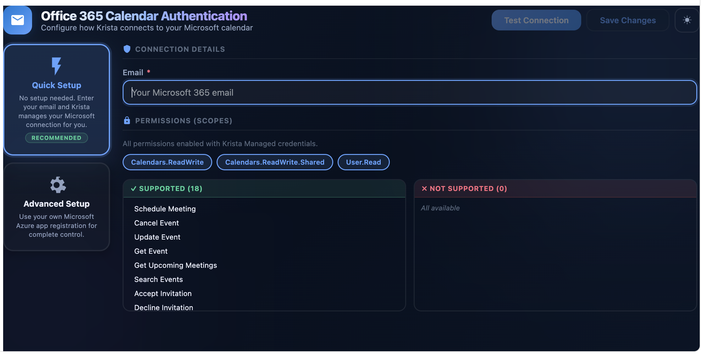
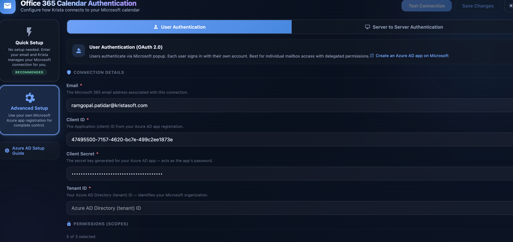
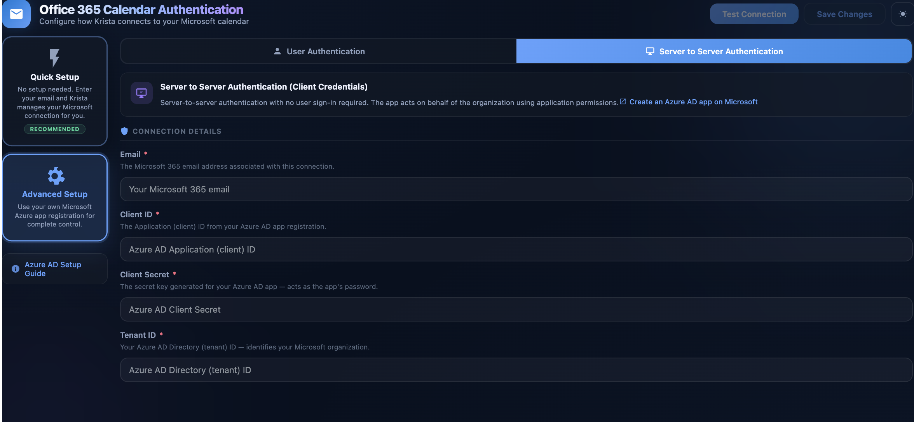

# Authentication

## Overview

The Office 365 Calendar Extension uses Microsoft OAuth 2.0 and Azure AD authentication to securely connect with Microsoft Graph API. It supports three authentication configurations, each suited for different organizational needs:

| # | Configuration | Auth Flow | User Sign-In | Best For |
|---|--------------|-----------|--------------|----------|
| 1 | **OAuth 2.0 — Krista Managed** | Authorization Code (Delegated) | Yes | Quick setup, testing, small teams |
| 2 | **OAuth 2.0 — Your Own Credentials** | Authorization Code (Delegated) | Yes | Enterprise control, custom permissions |
| 3 | **Server-Server Authentication** | Client Credentials (Application) | No | Automated workflows, no user interaction |

## Authentication Tab

The **Authentication** tab in the extension provides a unified interface for configuring all three types. It is divided into two selection steps:

- **Step 1** — Choose the auth flow: **User Authentication** (OAuth 2.0, user sign-in) or **Server-Server Authentication** (app-only)
- **Step 2** — (User Authentication only) Choose credential mode: **Quick Setup** (Krista Managed) or **Advanced Setup** (Your Own Credentials)

After selecting the type, enter the required fields, click **Test Connection**, and then **Save Changes**.

---

## Type 1: OAuth 2.0 — Krista Managed



### What It Is

Uses Krista's pre-registered Azure AD application for authentication. The user signs in via a browser popup and grants delegated permissions. No Azure portal configuration is required.

### When to Use

- Getting started quickly with minimal setup
- Development and testing environments
- Organizations where Azure AD app registration is not available
- Small teams that don't need custom permission policies

### Required Fields

| Field | Required | Description |
|-------|----------|-------------|
| Email | Yes | Microsoft 365 work or school email address |

### How It Works

1. Select **User Authentication** in Step 1
2. Select **Quick Setup** in Step 2
3. Enter your Microsoft 365 email address
4. Click **Test Connection** — a Microsoft sign-in popup opens
5. Sign in with the email account and grant the requested permissions
6. After the popup closes, the connection is verified automatically
7. Click **Save Changes** to persist the configuration

### Authentication Flow

```
User clicks Test Connection
  → Browser popup opens Microsoft login page
  → User signs in and grants consent to Krista's Azure AD app
  → Microsoft returns authorization code to callback URL
  → Extension exchanges code for access + refresh tokens
  → Tokens stored securely under the invoker ID
  → Subsequent API calls use stored tokens with automatic refresh
```

### Scopes

All scopes are enabled automatically with Krista Managed credentials:

| Scope | Purpose |
|-------|---------|
| `openid` | User authentication and identity |
| `offline_access` | Refresh token for long-term access |
| `Calendars.ReadWrite` | Read and write user calendars |
| `Calendars.ReadWrite.Shared` | Read and write shared and delegated calendars |
| `User.Read` | Read basic user profile |

### Supported Features

When Quick Setup is selected, the extension UI shows which operations are available with Krista Managed credentials. All 18 calendar operations are supported (0 not supported):

| Supported Operations |
|----------------------|
| Schedule Meeting |
| Cancel Event |
| Update Event |
| Get Event |
| Get Upcoming Meetings |
| Search Events |
| Accept Invitation |
| Decline Invitation |
| Tentative Invitation |
| Forward Event |
| Get Attachments |
| Get Attachments For A Given User |
| Get Events For A Given User |
| Get Free Slots |
| Get Next Upcoming Meetings |
| Get Schedules |
| Add Attendees |
| Remove Attendee |

All operations are available because `Calendars.ReadWrite`, `Calendars.ReadWrite.Shared`, and `User.Read` cover the full scope of calendar actions.

### Limitations

- Cannot customize which scopes are requested
- Cannot apply organization-specific conditional access policies
- Cannot restrict to a single tenant
- Krista's Azure AD app is shared across all Krista Managed users

---

## Type 2: OAuth 2.0 — Your Own Credentials



### What It Is

Uses your own Azure AD application for delegated authentication. The user still signs in via a browser popup, but authentication flows through your organization's Azure AD tenant. This provides full control over permissions, conditional access policies, and audit logging.

### When to Use

- Production environments requiring enterprise-grade security
- Organizations with conditional access or MFA policies
- When you need full audit trails through Azure AD logs
- When you need to restrict authentication to your tenant only

### Prerequisites

- A registered Azure AD application (see [Creating Office 365 App](pages/CreatingOffice365App.md))
- Application (Client) ID, Client Secret, and Directory (Tenant) ID
- Delegated permissions granted with admin consent
- Redirect URI configured: `{extension-base-url}/rest/calendar/callback`

### Required Fields

| Field | Required | Description |
|-------|----------|-------------|
| Email | Yes | Microsoft 365 work or school email address |
| Client ID | Yes | Application (Client) ID from Azure AD app registration |
| Client Secret | Yes | Client secret value (not the secret ID) |
| Tenant ID | No | Directory (Tenant) ID from Azure AD (optional — leave blank for multi-tenant) |

### How It Works

1. Select **User Authentication** in Step 1
2. Select **Advanced Setup** in Step 2
3. Enter email, Client ID, Client Secret, and optionally Tenant ID
4. Click **Test Connection** — a Microsoft sign-in popup opens
5. Sign in and grant consent to your Azure AD app
6. After the popup closes, the connection is verified
7. Click **Save Changes** to persist the configuration

### Authentication Flow

```
User clicks Test Connection
  → Browser popup opens: https://login.microsoftonline.com/{tenant_id}/oauth2/v2.0/authorize
  → User authenticates against your Azure AD tenant
  → Conditional access policies and MFA are enforced
  → User grants consent to your Azure AD application
  → Microsoft returns authorization code to callback URL
  → Extension exchanges code + client_secret for access + refresh tokens
  → Tokens stored securely under the invoker ID
```

### Redirect URI

Your Azure AD application must have the following redirect URI configured:

```
{extension-base-url}/rest/calendar/callback
```

To find the extension base URL:
1. Go to the extension's **Details** tab in Krista
2. Copy the base URL
3. Append `/rest/calendar/callback`

Example: `https://extension.solution.eng.krista.app/extension/api/HU2iSsKQfxylhTLYbASL_pw_e_e/rest/calendar/callback`

---

## Type 3: Server-Server Authentication



### What It Is

Uses the OAuth 2.0 Client Credentials flow for app-only authentication. No user sign-in is required. The extension authenticates directly as the application using Client ID and Client Secret, and accesses the Calendar API via the `/users/{email}` endpoint instead of `/me`.

### When to Use

- Fully automated workflows where no user is present to sign in
- Background processing and scheduled tasks
- Server-to-server integrations
- When the application needs to access calendars on behalf of the organization

### Prerequisites

- A registered Azure AD application (see [Creating Office 365 App](pages/CreatingOffice365App.md))
- Application (Client) ID, Client Secret, and Directory (Tenant) ID
- **Application permissions** (not delegated) granted with admin consent
- Redirect URI is **not required** for this flow

### Required Fields

| Field | Required | Description |
|-------|----------|-------------|
| Email | Yes | The target account email address to access the calendar as |
| Client ID | Yes | Application (Client) ID from Azure AD app registration |
| Client Secret | Yes | Client secret value (not the secret ID) |
| Tenant ID | Yes | Directory (Tenant) ID from Azure AD |

### How It Works

1. Select **Server-Server Authentication** in Step 1
2. Enter email, Client ID, Client Secret, and Tenant ID
3. Click **Test Connection** — no browser popup; the extension authenticates directly
4. If successful, click **Save Changes** to persist the configuration

### Authentication Flow

```
Extension sends POST to:
  https://login.microsoftonline.com/{tenant_id}/oauth2/v2.0/token

  client_id={your_client_id}
  &client_secret={your_client_secret}
  &grant_type=client_credentials
  &scope=https://graph.microsoft.com/.default

  → Microsoft validates client credentials
  → Returns access token (no refresh token)
  → Extension uses /users/{email}/... endpoints (not /me)
  → Token cached and refreshed automatically before expiry
```

### Key Differences from OAuth 2.0

| Aspect | OAuth 2.0 (Types 1 & 2) | Server-Server Authentication (Type 3) |
|--------|--------------------------|-------------------------------|
| User sign-in | Required | Not required |
| Token type | Delegated (user + app) | Application-only |
| Graph API path | `/me/...` | `/users/{email}/...` |
| Refresh token | Yes | No (new token requested on expiry) |
| Permissions type | Delegated | Application |

### Azure AD Application Permissions

For Server-Server Authentication, you need **Application permissions** (not delegated):

1. Go to Azure AD > App registrations > your app > API permissions
2. Click **Add a permission** > **Microsoft Graph** > **Application permissions**
3. Add required permissions:
   - `Calendars.ReadWrite` — Read and write calendars for all users
4. Click **Grant admin consent for [Your Organization]**

---

## Token Management

### Access Tokens

| Property | OAuth 2.0 (Types 1 & 2) | Server-Server Authentication (Type 3) |
|----------|--------------------------|-------------------------------|
| Lifetime | ~1 hour | ~1 hour |
| Refresh | Via refresh token | New client_credentials request |
| Storage | Encrypted, per-invoker | Encrypted, per-invoker |
| Key format | `email_clientId_Public` | `clientId_tenantId_Private` |

### Automatic Token Handling

The extension automatically handles:
- Token expiration detection before API calls
- Token refresh (or re-acquisition for Server-Server Authentication)
- Retry logic for transient failures
- Secure token storage and encryption
- Token cleanup on disconnection

### Token Errors

When a token-related error occurs, the extension classifies it and takes appropriate action:

| Error | Action | Re-auth Required |
|-------|--------|-----------------|
| Token expired | Remove stored token, prompt re-authentication | Yes |
| Password changed | Remove stored token, prompt re-authentication | Yes |
| Permissions revoked | Remove stored token, prompt re-consent | Yes |
| Invalid client secret | Surface error, keep token | No |
| User not found | Surface error, keep token | No |
| Service unavailable | Retry, keep token | No |

---

## Audit Dashboard

The **Calendar Audit** tab provides visibility into authentication events and catalog request activity. Every catalog request is automatically tracked:

| Event | When Recorded |
|-------|---------------|
| `CATALOG_REQUEST_TRIGGERED` | When a catalog request starts execution |
| `CATALOG_REQUEST_SUCCESS` | When a catalog request completes successfully |
| `CATALOG_REQUEST_FAILURE` | When a catalog request fails (validation error, exception, or auth error) |
| `TOKEN_REFRESHED` | When an access token is successfully refreshed |
| `TOKEN_EXPIRY_DETECTED` | When a token expiration error is caught |
| `INVALID_CLIENT_SECRET_DETECTED` | When a client secret error is caught |
| `PASSWORD_CHANGE_DETECTED` | When a user password change is detected |

The audit dashboard shows:
- **Credential Health** — current status of stored authentication credentials
- **Event Timeline** — chronological list of all audit events
- **Request Tracking** — each TRIGGERED event is paired with its SUCCESS or FAILURE outcome, including duration and execution logs

---

## Troubleshooting

### Test Connection Fails with No Popup (OAuth 2.0)

**Cause**: Browser popup blocked or redirect URI mismatch.
**Fix**: Allow popups for the Krista domain. Verify the redirect URI in Azure AD matches exactly: `{base-url}/rest/calendar/callback`.

### Test Connection Fails Immediately (Server-Server Authentication)

**Cause**: Invalid Client ID, Client Secret, or Tenant ID.
**Fix**: Verify all three values are copied correctly from Azure AD. Check that the client secret has not expired.

### Standard Users Cannot Sign In (OAuth 2.0 — Your Own Credentials)

**Cause**: Missing delegated scopes or incorrect permission types.
**Fix**: Ensure all required delegated scopes are granted with admin consent. See [Creating Office 365 App](pages/CreatingOffice365App.md) for details.

### Token Refresh Fails After Password Change

**Cause**: The stored refresh token is invalidated when the user changes their password.
**Fix**: Re-authenticate by clicking **Test Connection** and signing in again.

### AADSTS Error Codes

| Error Code | Meaning | Fix |
|-----------|---------|-----|
| AADSTS70002 | Invalid credentials | Verify Client ID, Secret, and Tenant ID |
| AADSTS65001 | Consent not granted | Request admin consent in Azure AD |
| AADSTS50011 | Redirect URI mismatch | Add the exact redirect URI from the extension Details tab to Azure AD |
| AADSTS70008 | Refresh token expired | Re-authenticate via Test Connection |
| AADSTS7000222 | Client secret expired | Generate a new client secret in Azure AD |

---

## Security Best Practices

1. **Use Server-Server Authentication for automated workflows** — avoids dependency on user tokens that can expire when passwords change
2. **Rotate client secrets regularly** — set a reminder before the expiration date shown in Azure AD
3. **Use Your Own Credentials for production** — provides full control and audit trails
4. **Grant minimal permissions** — only add the scopes your workflows actually need
5. **Monitor the Audit Dashboard** — watch for `TOKEN_EXPIRY_DETECTED` and `INVALID_CLIENT_SECRET_DETECTED` events

---

## See Also

- [Extension Configuration](pages/ExtensionConfiguration.md) — Step-by-step setup for each auth type
- [Creating Office 365 App](pages/CreatingOffice365App.md) — Azure AD application registration guide
- [Audit Dashboard](pages/AuditDashboard.md) — Audit trail and health monitoring
