# Creating Office 365 App Registration

## Overview

To use the Office 365 Calendar Extension, you must create an app registration in Microsoft Entra ID (formerly Azure AD). This app registration provides the OAuth 2.0 credentials (Client ID, Client Secret, and Tenant ID) required for secure authentication with Microsoft Graph Calendar API.

This guide provides step-by-step instructions for creating and configuring a Microsoft Entra ID app registration for the Office 365 Calendar Extension.

## Prerequisites

Before you begin, ensure you have:

- **Microsoft Entra ID Administrator Access**: You need permissions to create app registrations in your Microsoft Entra ID tenant
- **Office 365 Subscription**: An active Office 365 subscription with calendar access
- **Global Administrator or Application Administrator Role**: Required to grant admin consent for API permissions
- **Microsoft Account**: Access to the Azure Portal (https://portal.azure.com/)

## Step-by-Step Instructions

### Step 1: Access Azure Portal

1. Navigate to the [Azure Portal](https://portal.azure.com/)
2. Sign in with your administrator account

### Step 2: Navigate to Microsoft Entra ID

1. On the Azure Portal home page, under **Azure services**, click **Microsoft Entra ID**
2. If you don't see it immediately, click **More services** to find Microsoft Entra ID

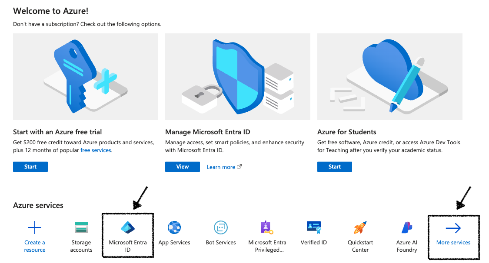

### Step 3: Access App Registrations

1. In the Microsoft Entra ID overview page, locate the left navigation menu
2. Under the **Manage** section, click **App registrations**

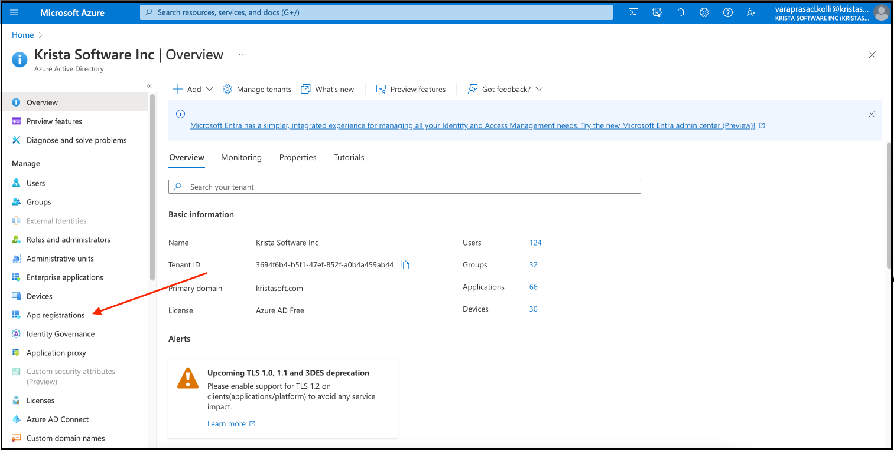

### Step 4: Create New App Registration

1. At the top of the App registrations page, click **+ New registration**
2. Alternatively, if you have an existing app registration you want to use, select it from the list

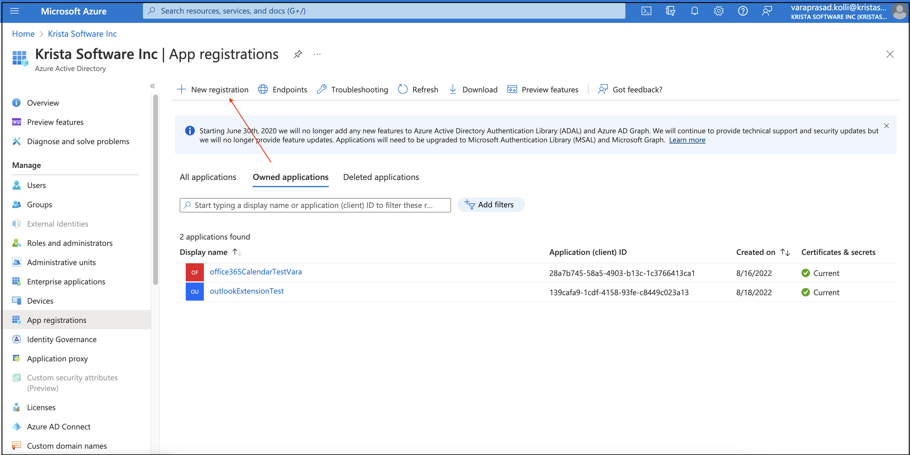

### Step 5: Configure App Registration

1. **Name**: Enter a descriptive name for your application (e.g., "Krista Office 365 Calendar Integration")
2. **Supported account types**: Select **Accounts in this organizational directory only (Single tenant)**
3. **Redirect URI**: Select **Web** platform and add the authorized redirect URI corresponding to your Office 365 Calendar extension
   - Format: `{Extension Base URL}/office365calendar/callback`
   - Example: `https://your-krista-instance.com/office365calendar/callback`
4. Click **Register**

### Step 6: Note Client ID and Tenant ID

After registration, you'll be taken to the app's overview page:

1. Copy the **Application (client) ID** - you'll need this for the extension configuration
2. Copy the **Directory (tenant) ID** - you'll also need this for the extension configuration
3. Save these values in a secure location

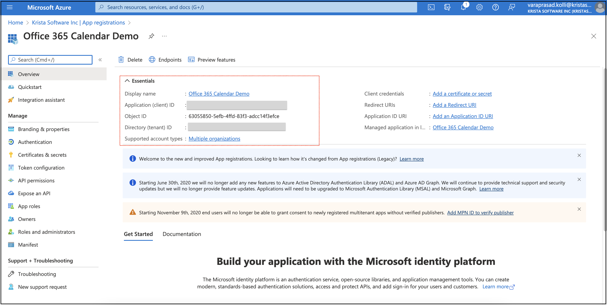

### Step 7: Configure API Permissions

#### Add Delegated Permissions

1. In the left navigation menu, click **API permissions**
2. Click **+ Add a permission**
3. Select **Microsoft Graph**

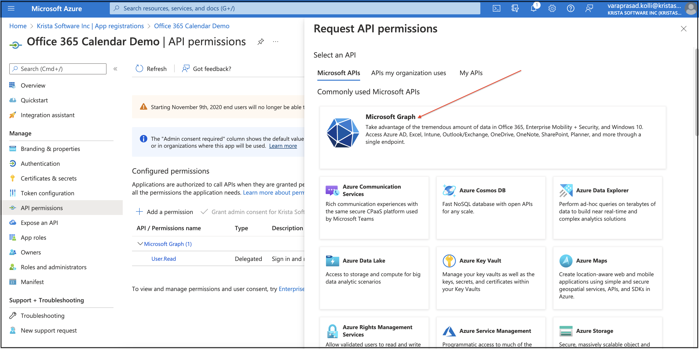

4. Select **Delegated permissions**
5. Search for and select the following permissions:
   - **Calendars.ReadWrite** - Read and write user calendars
   - **Calendars.ReadWrite.Shared** - Read and write user and shared calendars
   - **offline_access** - Maintain access to data you have given it access to
   - **openid** - Sign users in
   - **profile** - View users' basic profile
6. Click **Add permissions**

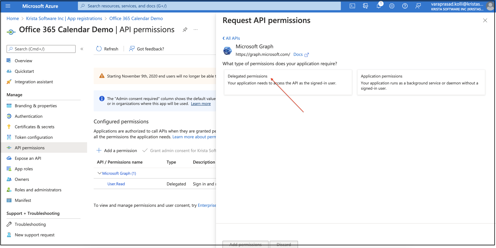

#### Add Application Permissions (Optional)

> **Note**: Application permissions are optional and only required for certain system requests where user interaction is not needed.

1. Click **+ Add a permission** again
2. Select **Microsoft Graph**
3. Select **Application permissions**
4. Search for and select:
   - **Calendars.ReadBasic.All** - Read basic details of calendars in all mailboxes
5. Click **Add permissions**

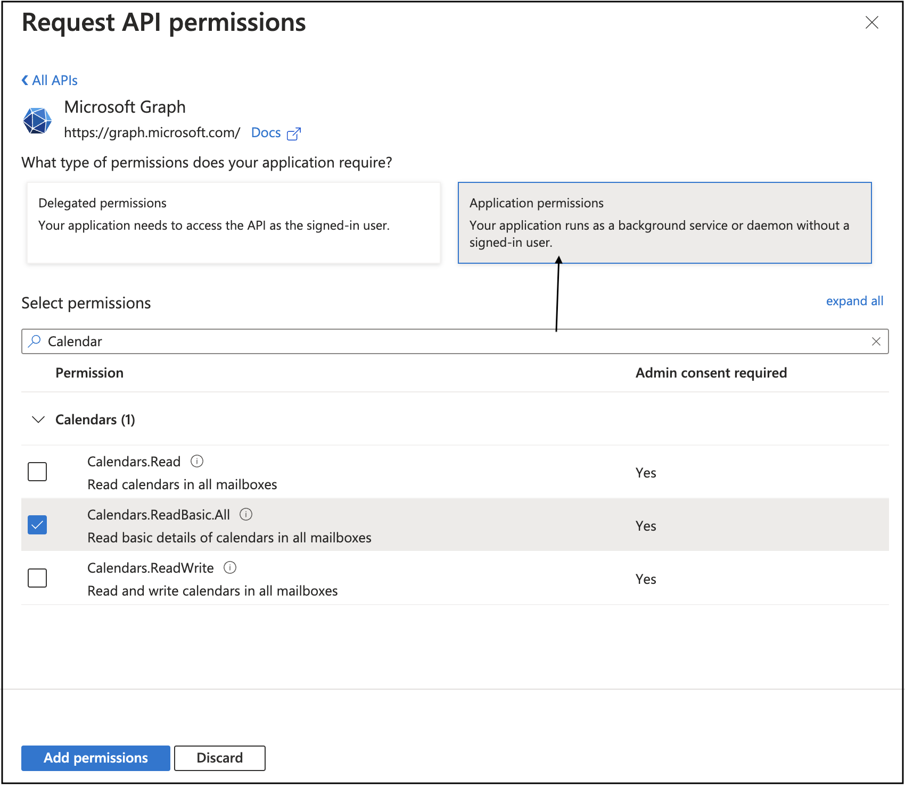

#### Grant Admin Consent

1. Click **Grant admin consent for [Your Organization]**
2. Confirm by clicking **Yes**
3. Verify that all permissions show a green checkmark under "Status"

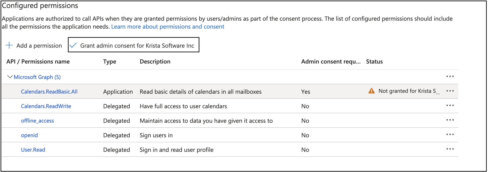

### Step 8: Create Client Secret

1. In the left navigation menu, click **Certificates & secrets**
2. Under **Client secrets**, click **+ New client secret**

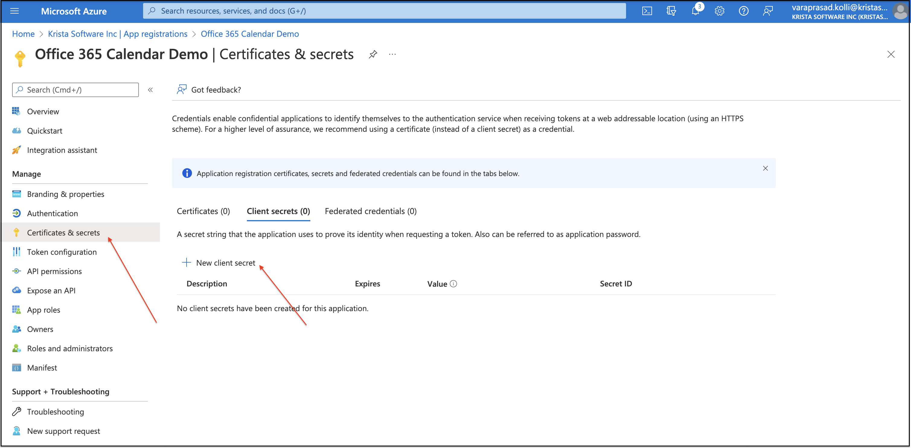

3. Enter a description (e.g., "Krista Extension Secret")
4. Select an expiration period (recommended: 24 months)
5. Click **Add**

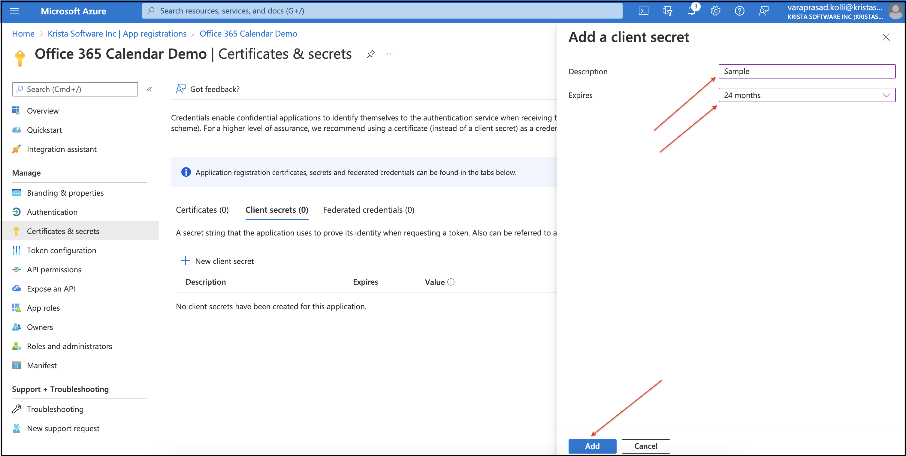

6. **IMPORTANT**: Copy the secret **Value** immediately - it will only be shown once
7. Save this value securely

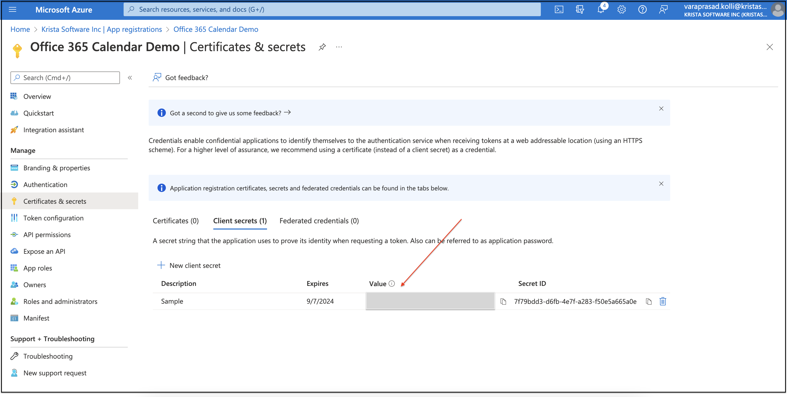

### Step 9: Verify Redirect URI

1. In the left navigation menu, click **Authentication**
2. Under **Platform configurations**, verify the redirect URI is correctly configured
3. Ensure the redirect URI matches: `{Extension Base URL}/office365calendar/callback`

### Step 10: Verify Configuration

Ensure you have collected all required information:

- ✅ Application (client) ID
- ✅ Directory (tenant) ID
- ✅ Client Secret Value
- ✅ Redirect URI configured
- ✅ API permissions granted
- ✅ Admin consent provided

## Required API Permissions

### Delegated Permissions

| Permission | Description | Required |
|------------|-------------|----------|
| Calendars.ReadWrite | Read and write user calendars | Yes |
| Calendars.ReadWrite.Shared | Read and write user and shared calendars | Yes |
| offline_access | Maintain access to data | Yes |
| openid | Sign users in | Yes |
| profile | View users' basic profile | Yes |

### Application Permissions (Optional)

| Permission | Description | Required |
|------------|-------------|----------|
| Calendars.ReadBasic.All | Read basic details of calendars in all mailboxes | No (Optional) |

## Security Considerations

### 1. Client Secret Management

- **Expiration**: Client secrets expire. Set a reminder to renew before expiration
- **Rotation**: Rotate secrets regularly (every 12-24 months)
- **Storage**: Store secrets securely (use Azure Key Vault or similar)
- **Access**: Limit who has access to view or manage secrets

### 2. Permissions

- **Principle of Least Privilege**: Only grant necessary permissions
- **Admin Consent**: Required for organization-wide access
- **Review Regularly**: Audit permissions periodically

### 3. Redirect URI

- **HTTPS Only**: Always use HTTPS for redirect URIs
- **Exact Match**: The redirect URI must match exactly (including trailing slashes)
- **No Wildcards**: Wildcards are not supported in redirect URIs

### 4. App Registration Security

- **Single Tenant**: Use single tenant for better security
- **Monitor Usage**: Review sign-in logs regularly
- **Conditional Access**: Consider implementing conditional access policies

## Troubleshooting

### Issue: "Insufficient Privileges to Complete the Operation"

**Cause**: You don't have permissions to create app registrations

**Solution**:
1. Contact your Microsoft Entra ID administrator
2. Request Application Administrator or Global Administrator role
3. Alternatively, ask an administrator to create the app registration for you

### Issue: "Admin Consent Required"

**Cause**: API permissions require admin consent

**Solution**:
1. Contact your Global Administrator
2. Ask them to grant admin consent for the app registration
3. In the app registration, go to API permissions → Grant admin consent

### Issue: "Client Secret Not Visible"

**Cause**: Client secret value is only shown once when created

**Solution**:
1. Create a new client secret
2. Copy the value immediately
3. Delete the old secret if it's no longer needed
4. Update the extension configuration with the new secret

### Issue: "Redirect URI Mismatch"

**Cause**: The redirect URI in the app registration doesn't match the extension configuration

**Solution**:
1. Verify the Extension Base URL in Krista
2. Ensure the redirect URI is: `{Extension Base URL}/office365calendar/callback`
3. Check for trailing slashes and ensure exact match
4. Update the redirect URI in the app registration if needed

### Issue: "Permission Not Granted"

**Cause**: Required permissions are not granted or admin consent is missing

**Solution**:
1. Verify all required permissions are added
2. Ensure admin consent has been granted (green checkmarks)
3. Wait a few minutes for permissions to propagate
4. Try re-authenticating the extension

## Next Steps

After completing the app registration:

1. **Configure Extension**: Use the Client ID, Client Secret, and Tenant ID in the [Extension Configuration](pages/ExtensionConfiguration.md)
2. **Set Up Authentication**: Choose between service account or user account authentication in [Authentication](pages/Authentication.md)
3. **Test Connection**: Validate the extension configuration to ensure proper connectivity

## See Also

- [Extension Configuration](pages/ExtensionConfiguration.md) - Configure the extension with app registration details
- [Authentication](pages/Authentication.md) - Understanding OAuth 2.0 authentication modes
- [Microsoft Entra ID Documentation](https://learn.microsoft.com/en-us/azure/active-directory/) - Official Microsoft documentation
- [Microsoft Graph Permissions Reference](https://learn.microsoft.com/en-us/graph/permissions-reference) - Complete permissions list

