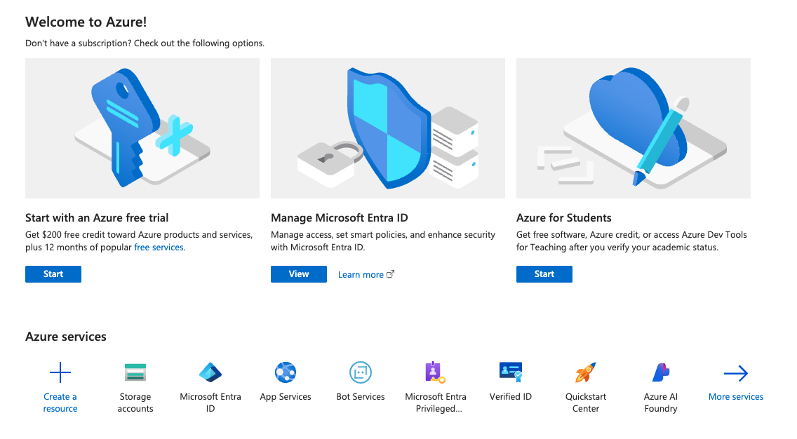
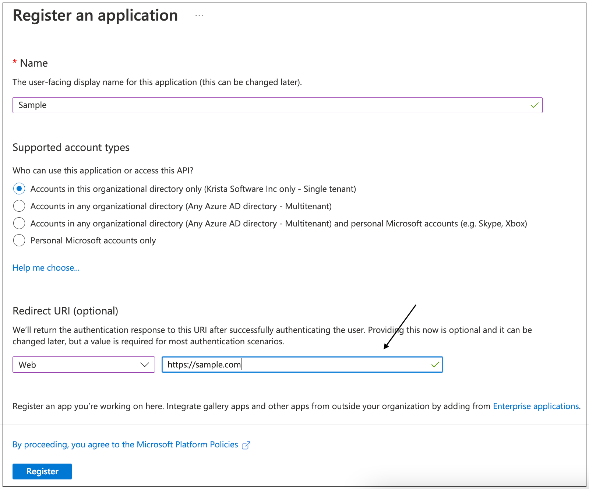

# Extension Configuration

## Overview

The Office 365 Calendar Extension supports three authentication configurations. This guide provides step-by-step setup instructions for each one using the **Authentication** tab.

| Configuration | When to Use |
|--------------|-------------|
| **OAuth 2.0 — Krista Managed** | Quick setup, no Azure AD app needed |
| **OAuth 2.0 — Your Own Credentials** | Enterprise control with your own Azure AD app |
| **Server-Server Authentication** | Automated workflows, no user sign-in |

For a detailed comparison and technical details, see [Authentication](pages/Authentication.md).

---

## Adding the Office 365 Calendar Extension

1. Navigate to **Catalogs** > **Essentials** > **Collaboration** > **Office 365 Calendar**
2. Click **Add to Workspace**
3. Provide an **Extension Name** in the Setup dialog
4. Click **Save**

---

## Configuration 1: OAuth 2.0 — Krista Managed

This is the simplest configuration. Krista's built-in Azure AD application handles all authentication. No Azure portal setup is required.

### Prerequisites

- A Microsoft 365 work or school email account
- Ability to sign in and grant consent in a browser popup

### Setup Steps

1. Open the **Authentication** tab in the extension
2. In **Step 1**, select **User Authentication**
3. In **Step 2**, select **Quick Setup** (this is the default and recommended option)
4. Enter your **Email** address
5. Click **Test Connection**
6. A browser popup opens — sign in with your Microsoft 365 account
7. Grant the requested permissions when prompted
8. The popup closes automatically and the connection is verified
9. Click **Save Changes** to persist the configuration

### Parameters

| Field | Required | Example |
|-------|----------|---------|
| Email | Yes | `user@company.com` |

### Notes

- All scopes are automatically enabled — you cannot customize them in this mode
- If you need to customize scopes or apply conditional access policies, use **Your Own Credentials** instead

---

## Configuration 2: OAuth 2.0 — Your Own Credentials

Uses your own Azure AD application for delegated authentication. You control the app registration, permissions, and policies.

### Prerequisites

- A registered Azure AD application with delegated permissions and admin consent
- Application (Client) ID, Client Secret, and Directory (Tenant) ID
- Redirect URI configured in the Azure AD app: `{extension-base-url}/rest/calendar/callback`

> If you haven't created an Azure AD app yet, follow the [Creating Office 365 App](pages/CreatingOffice365App.md) guide first.

### Setup Steps

1. Open the **Authentication** tab in the extension
2. In **Step 1**, select **User Authentication**
3. In **Step 2**, select **Advanced Setup**
4. Enter the following fields:

| Field | Required | Where to Find |
|-------|----------|---------------|
| Email | Yes | Your Microsoft 365 email address |
| Client ID | Yes | Azure AD > App registrations > your app > Overview > Application (client) ID |
| Client Secret | Yes | Azure AD > App registrations > your app > Certificates & secrets > Client secret **Value** |
| Tenant ID | No | Azure AD > App registrations > your app > Overview > Directory (tenant) ID |

5. Click **Test Connection**
6. A browser popup opens — sign in with your Microsoft 365 account
7. Grant consent to your Azure AD app
8. The popup closes and the connection is verified
9. Click **Save Changes**

### Redirect URI Configuration

Your Azure AD app must have the correct redirect URI:

1. Go to the extension's **Details** tab in Krista and copy the base URL
2. Append `/rest/calendar/callback`
3. In Azure AD, go to App registrations > your app > Authentication
4. Click **Add a platform** > **Web**
5. Enter the full redirect URI and click **Configure**

Example: `https://extension.solution.eng.krista.app/extension/api/HU2iSsKQfxylhTLYbASL_pw_e_e/rest/calendar/callback`

### Required Delegated Permissions

Ensure these are added as **Delegated** permissions in Azure AD with admin consent:

- `openid`
- `offline_access`
- `Calendars.ReadWrite`
- `Calendars.ReadWrite.Shared`
- `User.Read`

---

## Configuration 3: Server-Server Authentication

Uses the OAuth 2.0 Client Credentials flow. The extension authenticates as the application itself — no user sign-in or browser popup is required. This is ideal for fully automated, unattended workflows.

### Prerequisites

- A registered Azure AD application with **Application** permissions and admin consent
- Application (Client) ID, Client Secret, and Directory (Tenant) ID
- No redirect URI is needed for this flow

### Setup Steps

1. Open the **Authentication** tab in the extension
2. In **Step 1**, select **Server-Server Authentication**
3. Enter the following fields:

| Field | Required | Where to Find |
|-------|----------|---------------|
| Email | Yes | The target account email address the extension will access the calendar as |
| Client ID | Yes | Azure AD > App registrations > your app > Overview > Application (client) ID |
| Client Secret | Yes | Azure AD > App registrations > your app > Certificates & secrets > Client secret **Value** |
| Tenant ID | Yes | Azure AD > App registrations > your app > Overview > Directory (tenant) ID |

4. Click **Test Connection** — the extension authenticates directly (no popup)
5. If successful, click **Save Changes**

### Required Application Permissions

In Azure AD, add these as **Application permissions** (not Delegated):

1. Go to App registrations > your app > API permissions
2. Click **Add a permission** > **Microsoft Graph** > **Application permissions**
3. Add:
   - `Calendars.ReadWrite` — Read and write calendars for all users
4. Click **Grant admin consent for [Your Organization]**

### Key Differences

- **No browser popup** — Test Connection authenticates directly using client credentials
- **Email field** — specifies which account to access, not who signs in
- **Graph API uses** `/users/{email}/...` instead of `/me/...`
- **No refresh token** — the extension requests a new access token when the current one expires

> **Important**: Application permissions grant access across the entire organization. The Email field determines which specific account the extension operates as.

---

## Switching Between Configurations

You can switch between authentication types at any time:

1. Open the **Authentication** tab
2. Select the new auth type in Step 1 (and Step 2 if applicable)
3. Enter the required credentials for the new type
4. Click **Test Connection** to verify
5. Click **Save Changes**

> **Note**: Switching types clears the current credentials. The previous configuration is overwritten when you save.

---

## Troubleshooting

### Test Connection: Popup Doesn't Open

- **Cause**: Browser is blocking popups for this site
- **Fix**: Allow popups for the Krista platform domain in your browser settings

### Test Connection: Popup Opens But Fails (AADSTS50011)

- **Cause**: Redirect URI mismatch between Azure AD and the extension
- **Fix**: Copy the exact base URL from the extension's **Details** tab and append `/rest/calendar/callback`. Add that full URI to Azure AD > your app > Authentication > Redirect URIs.

### Test Connection: Fails Immediately (Server-Server Authentication)

- **Cause**: Invalid Client ID, Client Secret, or Tenant ID
- **Fix**: Double-check all three values from Azure AD. Verify the client secret hasn't expired.

### Save Changes Button Stays Disabled

- **Cause**: Test Connection must succeed before saving
- **Fix**: Click Test Connection first. The Save Changes button enables only after a successful test.

### Catalog Requests Fail After Successful Setup

- **Cause**: Missing permissions for the specific operation
- **Fix**: Check the [Authentication](pages/Authentication.md) scope table to see which scope is needed. For OAuth 2.0, ensure all required delegated permissions have admin consent. For Server-Server Authentication, add the Application permission in Azure AD.

---

## See Also

- [Authentication](pages/Authentication.md) — Technical details on auth flows, token management, and security
- [Creating Office 365 App](pages/CreatingOffice365App.md) — Azure AD application registration guide
- [Audit Dashboard](pages/AuditDashboard.md) — Audit trail and health monitoring
