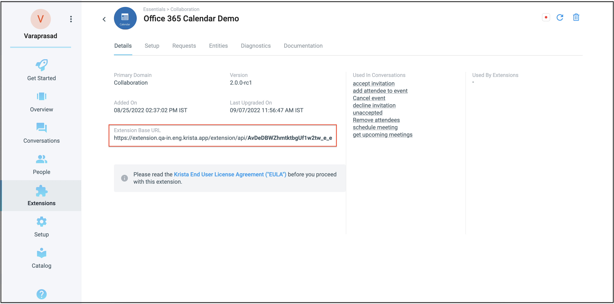

# Connecting with Krista Calendar Extension

To establish a connection with the Calendar Extension, follow the steps below based on your authentication method.

---

## 🔓 Using Public Authentication

1. Navigate to the Authentication tab in the Calendar Extension and select Public.
2. Enter your school or work email ID, then click on Test Connection.
   
   > Note:
   > If a shared account ID was provided during setup, use the service account credentials in the Microsoft login window.
3. Once authentication is successful, click on Save Changes.
4. You are now ready to use the extension for calendar requests.

---

## 🔐 Using Private Authentication

1. To set up the connection using Private Authentication, gather the following details from your registered Azure application:
   - Client ID
   - Client Secret
   - Tenant ID

2. In the Calendar Extension, go to the Details tab and copy the Extension Base URL.

3. Append `/rest/calendar/callback` to the base URL. This full URL will be needed when registering your Azure app.
   
   

4. To get the required credentials, navigate to the Obtaining Credentials For Private Authentication page or [click here](pages/obtainingClientIDClientSecret.md).

5. Go to the Authentication tab and select Private.

6. Provide the following:
   - Email
   - Client ID
   - Client Secret
   - Tenant ID

   Then click Test Connection.

   > Note:
   > If a shared account ID was provided during setup, use the service account credentials in the Microsoft login window.

7. Once the authentication succeeds, click on Save Changes.

8. Return to the extension setup page and click Validate.

9. In the resulting Authentication tab, authorize using the same account credentials you used when registering your Azure application.

10. You are now all set to use the extension for requests.

